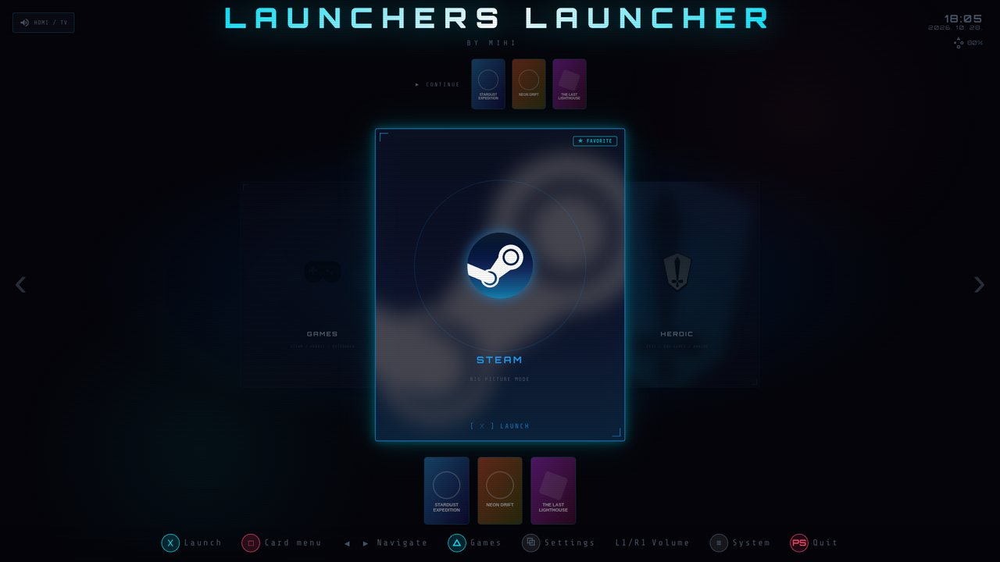

<p align="center"></p>

This launcher was created because I'm lazy.

I was too lazy to grab a mouse every time I wanted to launch a game from a different launcher.

I was too lazy to turn on the TV, switch the audio output, and take care of all the other stuff every time I sat down in front of it.

I was too lazy to look for the TV remote.

I was too lazy to browse through my games in emulators that didn't have a library feature (melonDS).

I was too lazy to search for my most recently played games in each emulator.

I was too lazy to remember which launcher or emulator I needed to open.

I was too lazy to write the code manually.

All I wanted was to pick up my controller and play.

And that's how the Launchers Launcher was born — out of pure laziness.

---

A full-screen, controller-navigable kiosk launcher for a living-room Linux PC.
Built with Electron for **KDE Plasma (Wayland)** and **GNOME (X11 / Wayland)**. It
launches Steam, Heroic (GOG/Epic/Amazon), RetroArch and a growing list of
emulators — plus individual games — and coordinates a "TV mode": switching the
active monitor and audio output, powering the TV on over HDMI-CEC, and closing
desktop apps when a Bluetooth controller connects.



> **Status:** version 1.x, built for one living-room PC and tested on a few
> machines (see [Limitations](#limitations)). It shells out to `kscreen-doctor`
> (KDE) or Mutter's D-Bus API (GNOME), `pactl` (PipeWire / PulseAudio),
> `bluetoothctl` and `gdbus`; expect to adjust connector names, sink names and
> app lists for your machine. There is an installer and a first-run setup wizard;
> the rest is controller-driven settings screens. The interface is available in
> English and Hungarian.

**User guide (with screenshots): [docs/user-guide/README.md](docs/user-guide/README.md).**

## What it does

- **Carousel launcher** — Steam / Heroic / RetroArch / any app you add, driven by a
  gamepad (DualSense, DualShock, Xbox; keyboard fallback for testing).
- **Game-level launching** — one Games panel for installed Steam, Heroic and Lutris
  games, RetroArch playlists and the libraries of Ryujinx, PCSX2, DuckStation,
  PPSSPP, Dolphin, Cemu, RPCS3 and melonDS (plus custom ROM folders); launch a
  specific title, with cover art, favourites and play time.
- **TV mode** — on Bluetooth controller connect: close configured desktop apps,
  start the launcher, switch display + audio to the saved output, and power the
  TV on via CEC (only when the startup monitor *is* the TV).
- **Settings**, all controller-driven — startup output, 15 themes, navigation
  sound/rumble, reduced motion / high contrast, Bluetooth headset & controller
  pairing, "main controller" filter, launcher order, per-launcher accent colour,
  diagnostics, log viewer.
- Idle screensaver (bouncing icons + clock, for OLED burn-in), recent-games quick
  bar, passive usage stats.

## Requirements

Runtime — host commands the launcher calls:

`./install.sh` installs everything below for you after one confirmation (see
[Install](#install)); the table is for reference / manual installs.

| Need | Fedora | Arch | Debian/Ubuntu |
| --- | --- | --- | --- |
| Node.js 22.12+ / npm | installed by `install.sh` into `~/.local/share/launchers-launcher/node` if missing or too old | same | same |
| KDE Plasma (Wayland) or GNOME (X11 / Wayland) session | — | — | — |
| `git` | `git` | `git` | `git` |
| `kscreen-doctor` (KDE only) | `libkscreen` | `libkscreen` | `libkscreen-bin` |
| `pactl` | `pulseaudio-utils` | `libpulse` | `pulseaudio-utils` |
| `bluetoothctl` | `bluez` | `bluez-utils` | `bluez` |
| `gdbus` | `glib2` | `glib2` | `libglib2.0-bin` |
| `ncat` (auto-start only) | `nmap-ncat` | `nmap` | `ncat` |
| `flatpak` (for flatpak apps) | `flatpak` | `flatpak` | `flatpak` |
| `zstd` (smaller save backups) | `zstd` | `zstd` | `zstd` |

Optional:

| For | Need |
| --- | --- |
| TV power-on / volume over CEC | HDMI-CEC adapter (`/dev/cec*`), `cec-ctl` (from `v4l-utils`), `cec-toolbox`, and membership in the `video` group (`sudo usermod -aG video $USER`) |
| Steam games | Steam, native (`~/.steam`) or flatpak (`com.valvesoftware.Steam`) |
| Heroic games | Heroic, native or flatpak (`com.heroicgameslauncher.hgl`) |
| RetroArch ROMs | RetroArch, native or flatpak (`org.libretro.RetroArch`), with scanned playlists |

Most desktop GPUs have **no** HDMI-CEC — the TV-control features simply stay
hidden if no adapter is found.

## Install

One command (clones to `~/launchers-launcher`, then runs the installer):

```bash
curl -fsSL https://raw.githubusercontent.com/GergelyMihalyi/Launchers-Launcher/main/get-launchers-launcher.sh | bash
# answer every question with yes:  … | bash -s -- --yes
```

Or by hand:

```bash
git clone https://github.com/GergelyMihalyi/Launchers-Launcher.git ~/launchers-launcher
cd ~/launchers-launcher
./install.sh --dry-run     # preview every step
./install.sh               # packages + Node + npm install + menu entry; optionally auto-start
```

The path **must** be `~/launchers-launcher` — the systemd units and the watcher
script assume it. The installer:

- lists the missing distro packages and installs them **after one question**
  (`apt-get` / `dnf` / `pacman` via `sudo`; `--no-packages` only lists them,
  `--yes` answers every question with yes);
- if Node.js is missing or older than `package.json` `engines.node` (Debian 13
  ships 20.x), downloads the official Node build into
  `~/.local/share/launchers-launcher/node` — no `sudo`, SHA-256 checked; the watcher
  and the menu entry put it first on `PATH`;
- adds the Flathub remote (`--user`), and offers the `video` group when a CEC
  device exists;
- never touches autologin/SDDM; `--uninstall` removes the systemd units while
  keeping your config and `node_modules`.

If something is still missing later, **Settings → System → Diagnostics → Install
missing** (or □ on the wizard's last step) installs it from inside the launcher via
PackageKit (`pkcon`, falling back to `pkexec`) — the system asks for your password
in its own dialog, so a keyboard is needed for that step.

Or just `npm install && npm start` and skip the installer.

On first run a **setup wizard** walks you through language, launchers, startup
monitor, audio output, main controller, theme and the button layout (every step skippable; re-run any time from **Settings
→ System → Setup wizard**). It writes `~/.config/launchers-launcher/config.json`.

Settings and the wizard are controller-driven; the keyboard fallback covers the
main carousel (◀ ▶ move, Enter launch, Esc quit, `t` cycle theme) and basic
wizard navigation (▲ ▼ / Enter / Esc). Pair a gamepad before first setup, or
hand-edit `config.json` (see below).

### Auto-start on controller connect (optional)

`./install.sh` sets this up if you say yes. It is two `systemd --user` units;
neither service needs root (the watcher script needs one `sudo cp`). Manually:

**1. Watcher** — owns a Unix socket, runs `npm start`, restarts the launcher on
crash:

```bash
sudo cp bin/launchers-launcher-watcher.sh /usr/local/bin/
sudo chmod +x /usr/local/bin/launchers-launcher-watcher.sh
mkdir -p ~/.config/systemd/user
cp systemd/launchers-launcher-watcher.service ~/.config/systemd/user/
systemctl --user daemon-reload
systemctl --user enable --now launchers-launcher-watcher.service
```

**2. Bluetooth trigger** — a rootless BlueZ D-Bus listener (`gdbus monitor`); on
controller connect it runs `bin/tv-mode-enter.sh` (close apps + ping the socket).
Runs straight from the repo, so `git pull` updates it:

```bash
cp systemd/launchers-launcher-bt-trigger.service ~/.config/systemd/user/
systemctl --user daemon-reload
systemctl --user enable --now launchers-launcher-bt-trigger.service
```

For a headless / cold boot (trigger before you log in): `loginctl enable-linger
$USER`. Not needed with kiosk autologin.

### Local state

The launcher **writes nothing into the repo**. Everything machine-specific lives
under your home directory:

```
~/.config/launchers-launcher/config.json          all settings (see below)
~/.config/launchers-launcher/config.json.corrupt-*  auto-backup if config.json is ever unparseable
~/.local/share/launchers-launcher.log             launcher log (rotates at 2 MB)
~/.local/share/launchers-launcher-bt-trigger.log  BT trigger + tv-mode-enter log
~/.local/share/launchers-launcher-watcher.log     watcher log
~/.local/share/launchers-launcher-main-controller sidecar: the "main controller" MAC
~/.local/share/launchers-launcher-tvmode          sidecar: the tvMode close-list
~/.local/share/launchers-launcher.lock            written by the watcher while the launcher runs
~/launchers-launcher-saves/                       emulator save backups (Settings → Games → Back up game saves; folder configurable)
```

`./install.sh --uninstall` removes the systemd units but keeps `~/.config/launchers-launcher/`.
To wipe all state: `rm -rf ~/.config/launchers-launcher ~/.local/share/launchers-launcher*`.

### Save backups

**Settings → Games → Back up game saves** packs the emulators' save folders (memory cards, SAVEDATA,
save states — RetroArch, PCSX2, DuckStation, PPSSPP, Dolphin, Cemu, Ryujinx, RPCS3, melonDS) into
one `launchers-launcher-saves-<date>.tar.zst` (`.tar.gz` without `zstd`) in a folder you choose —
an external drive works too. The last 5 are kept. The same screen can back up automatically (after a
game or daily) and restores a chosen backup (a safety backup of the current saves is made first).
From a terminal (this overwrites the current saves): `tar -xf launchers-launcher-saves-<date>.tar.zst -C /`.

### Custom covers

A wrong or missing cover can be replaced without any UI: drop an image into

```
~/Pictures/launchers-launcher/covers/<source>/<id>.png        (also .jpg / .jpeg / .webp)
~/Pictures/launchers-launcher/covers/retroarch/<system>/<title>.png
```

`<source>` is the launcher id (`steam`, `heroic`, `lutris`, `ryujinx`, `pcsx2`, `cemu`, `rpcs3`,
`ppsspp`, `dolphin`, `melonds`, `duckstation`) and `<id>` the game's id (Steam appid, Heroic
appName, a serial / title id for the emulators). The exact path for a game is shown in its
details view (hold ✕ on a game in the Games panel). The override wins everywhere (Games panel, recent bars,
favourites) and is picked up on the next refresh — no restart needed.

### Machine-specific settings to review

Everything lives in `~/.config/launchers-launcher/config.json`:

| Key | What to change |
| --- | --- |
| `display` | Connector names (`DP-1`, `HDMI-A-1`, …) and the audio sink name are the author's. Set yours via **Settings → Display & audio → Startup display & audio**; the desktop-restore profile is auto-captured on first launch. |
| `tvMode` | Apps to close when TV mode starts + pre-commands. Empty by default. Flatpak apps are picked in **Settings → Startup → Close apps on TV mode**; the other two lists are edited by hand. `closeFlatpak` = flatpak app IDs, `closeNative` = exact process names, `preCommands` = shell strings run with `bash -lc`. |
| `mainController` | Which paired controller may trigger the launcher. Set via **Settings → Startup → Main controller**; empty = any controller. |
| `display.tvIsStartupMonitor` | `true` forces the CEC power-on at launch instead of relying on the connector match (for AVR pass-through or an always-on TV). |
| `display.cecTarget` | CEC logical address for volume/mute/power (default `0` = TV; `5` = an AVR / soundbar "Audio System"). |
| `display.standbyOnExit` | `true` also puts the TV into standby when you exit TV mode (Circle-hold). |

If the machine has no HDMI-CEC (`/dev/cec*`), all TV-control UI and hints are
hidden automatically and these keys are no-ops. CEC power-on otherwise fires only
when the CEC adapter's connector equals your startup monitor (i.e. "the TV is the
screen I boot into"), unless `tvIsStartupMonitor` overrides it.

### CEC-tested TVs

CEC behaviour is vendor-specific. What works so far:

| TV | Power on | Volume ± | Mute |
| --- | --- | --- | --- |
| LG (author's, over AMD `amdgpu` CEC) | ✅ (via `cec-toolbox`) | ✅ | ✅ |

If you get it working on another TV, a PR adding a row is welcome.

## Development

No build step, no bundler, no framework.

- `main.js` — Electron main process (wires the services together; window, IPC, lifecycle).
- `lib/**` — all the I/O logic, grouped by area (`ipc/`, `launchers/`, `launch/`,
  `output/`, …: parsers, config, launcher discovery, audio / displays / Bluetooth,
  launch state machine). No `electron` import — unit-testable.
- `renderer/**` — the UI, plain `<script src>` files sharing one global scope.
- `docs/dev/` — the developer documentation: architecture, per-module notes and
  the many hardware gotchas found along the way (start at [docs/dev/README.md](docs/dev/README.md)).

```bash
npm test          # node --test, no dependencies
```

To update: `git pull`, or **Settings → System → Update** (controller-driven —
`git fetch` + `git pull --ff-only` + relaunch, disabled if the working tree is
dirty). It runs `npm install` when `package.json` changed, and goes back to the
previous commit by itself if the new version does not start. The running version is in **Settings → System →
Diagnostics**; changes are logged in [CHANGELOG.md](CHANGELOG.md).

## Contributing and security

Bug reports and pull requests are welcome — see [CONTRIBUTING.md](CONTRIBUTING.md).
Security issues: see [SECURITY.md](SECURITY.md).

## Limitations

- **Desktops:** KDE Plasma on Wayland is the primary path. GNOME (X11 and Wayland) works
  with limits: no foreground-window activation, and no launcher-window moving on
  Wayland (see [docs/dev/platforms.md](docs/dev/platforms.md)). Other desktops take the KDE path.
- **Tested on a few machines only:** KDE/Wayland with an AMD GPU and an LG TV over HDMI-CEC,
  and Debian GNOME/X11 on an old laptop, with DualSense / DualShock / Xbox controllers.
  CEC behaviour in particular is vendor-specific; most desktop GPUs have no CEC at all.
- **UI language:** English or Hungarian (**Settings → Appearance → Language**, or the
  first-run wizard), applied live without a restart.
- **Updates** come from git (the in-launcher Update screen or `git pull`); there is no packaged
  release (an AppImage would conflict with the self-update and repo-run model).
- CEC volume/mute has no numeric feedback (TVs don't report it reliably).

## License

[MIT](LICENSE).

Third-party material:

- Launcher icons under `assets/icons/` are trademarks of their respective owners, bundled for
  identification only; they are not covered by the MIT license, and are removed on request.
- `themes/xp-bliss.jpg` is a look-alike landscape photo, ["Rolling green hills under a bright blue sky"](https://unsplash.com/photos/rolling-green-hills-under-a-bright-blue-sky-KvlCSWbsiR0)
  by Shibin Joseph, used under the [Unsplash License](https://unsplash.com/license) for the "Windows XP"
  theme background. It is not the original Microsoft wallpaper, and it is not covered by the MIT license.
- The app is built on [Electron](https://www.electronjs.org/) (MIT).
