# Launchers Launcher — user guide

Launchers Launcher is a full-screen, **controller-driven game launcher** for the PC connected to your living-room TV. From one
place you can start Steam, Heroic (GOG / Epic / Amazon), RetroArch, emulators (PCSX2, Dolphin, melonDS, …) or a single game
directly. You need neither a mouse nor a keyboard: everything works with the controller, from the couch.

> The screenshots come from the program's real interface, but with **made-up games**. On your own machine your installed games
> appear with their own covers.

**Contents**

1. [First start — the setup wizard](#1-first-start--the-setup-wizard)
2. [The controller buttons](#2-the-controller-buttons)
3. [The home screen](#3-the-home-screen)
4. [The Games panel](#4-the-games-panel)
5. [Settings](#5-settings)
6. [TV mode](#6-tv-mode)
7. [When something does not work](#7-when-something-does-not-work)
8. [Frequently asked questions](#8-frequently-asked-questions)

---

## 1. First start — the setup wizard

The first time you start the launcher, a short wizard greets you. In a few steps it sets up the most important things:

| Step | What you choose |
|---|---|
| Language | English or Hungarian |
| Launchers | which programs go on the home screen (the installed ones are ticked for you) |
| Startup monitor | which display the launcher starts on (e.g. the TV) |
| Audio output | where the sound goes (e.g. the TV's HDMI audio, a soundbar, headphones) |
| Main controller | which controller's connection starts TV mode |
| Theme | the look of the interface |
| Controls | a summary of the buttons — worth a look |

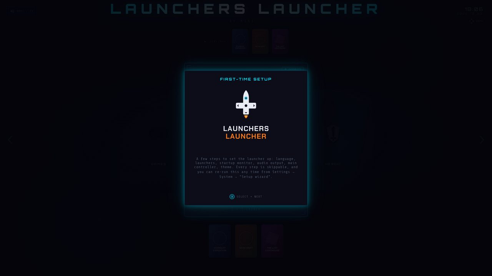

Use **✕** to choose and move on, **○** to go back. **Every step can be skipped** — whatever you skip can be set later in Settings.

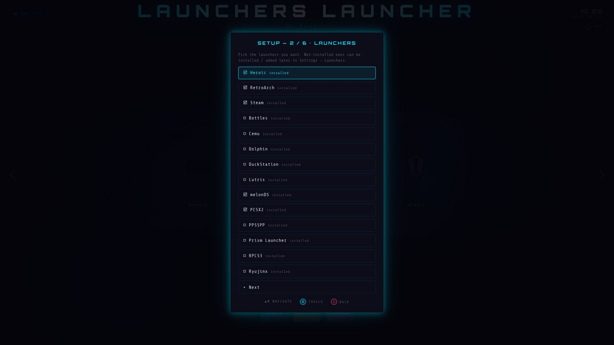

You can run the wizard again at any time: **Settings → System → Setup wizard**.

> **Tip:** pair the controller with the machine (Bluetooth) or plug it in over USB before the wizard. Without a controller, the
> wizard's basic navigation also works with the keyboard (▲ ▼, Enter, Esc).

---

## 2. The controller buttons

The labels show the **PlayStation controller's** symbols. With an Xbox controller the launcher switches to Xbox labels by itself;
the **position** of the buttons is the same:

| PlayStation | Xbox | What it does (on the home screen) |
|---|---|---|
| ✕ | A | launch / choose · **held:** card menu |
| ○ | B | back / cancel · **held for 5 s: leave TV mode** |
| □ | X | the card menu of the focused launcher card |
| △ | Y | open the **Games** panel |
| Share / Create | View (two squares) | **Settings** |
| Options | Menu (three lines) | **System menu** (power off, sleep, restart, quit) |
| L1 / R1 | LB / RB | volume down / up — always works, wherever you are |
| D-pad / left stick | D-pad / left stick | move |

**PS-button combos** (hold the PS / Xbox button and press another — the PS button alone does nothing, so it can never kick you
out by accident):

| Combo | Effect |
|---|---|
| PS + ○ | quit the launcher |
| PS + △ | disconnect **this** controller (before switching it off, to save battery) |
| PS + □ | "which controller am I?" — that controller rumbles and flashes |

The full button layout can also be viewed in the launcher: **Settings → Controllers → Controls**.

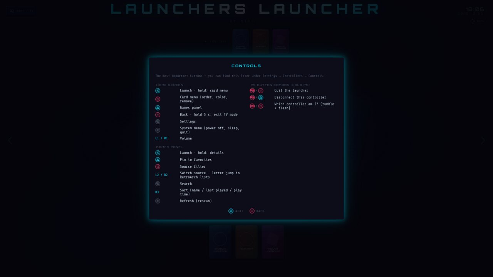

---

## 3. The home screen

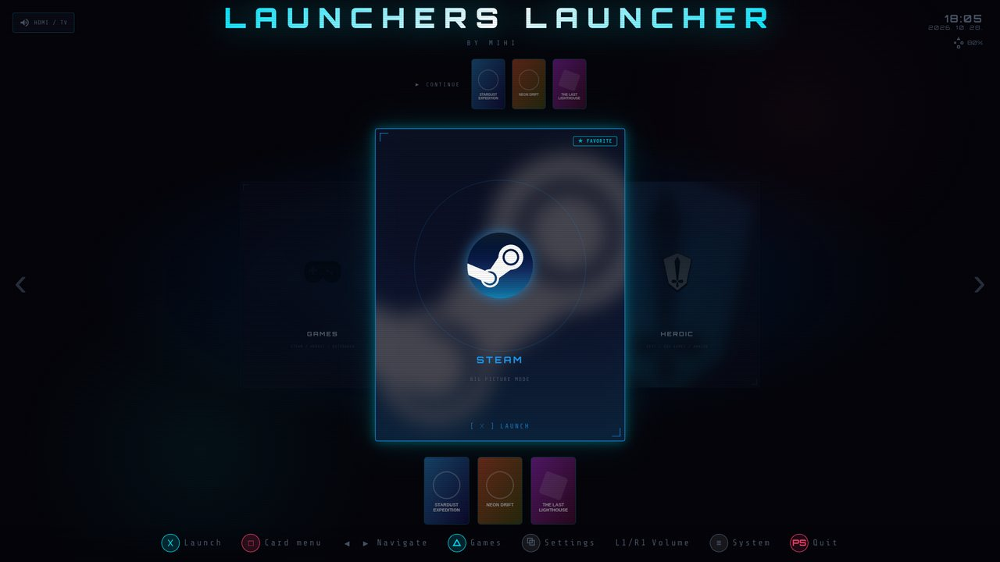

- **The cards in the middle:** every launcher (Steam, Heroic, RetroArch, …) is a card. **◀ ▶** scrolls, and the cards rotate
  around. **✕** starts the one in the middle.
- **The "Games" card** is always there: it shows the games of all launchers in a single list (the same as the **△** button, see
  [chapter 4](#4-the-games-panel)).
- **Badges on a card:** `★ FAVORITE` = your most used launcher; `● RUNNING` = the program is running right now (✕ then brings it
  to the front instead of starting it again).
- **Top right** are the clock, the date and the controller's battery level; **top left** the current audio output (e.g. the name
  of the TV or the headphones).
- At start-up the launcher is on the card you used **last**.

### The "▶ CONTINUE" bar (top)

The bar under the header shows the 3 most recently played games from **all** sources. From the cards, **▲** takes you up to it,
**◀ ▶** chooses, and **✕** starts the game right away, bypassing the launcher.

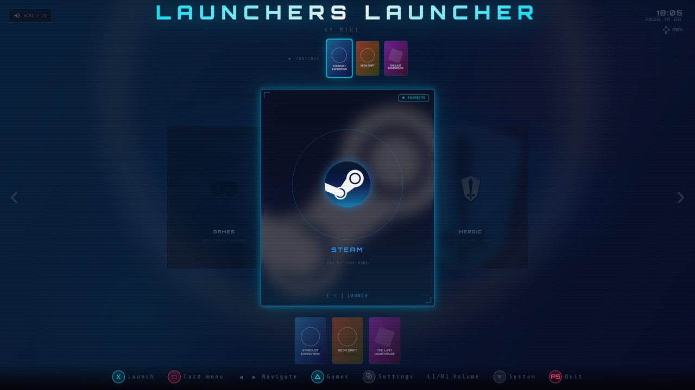

### Quick-launch bar (bottom)

Under the middle card you see the last 3 games of **that launcher**. **▼** takes you down to it, **▲** back to the card.

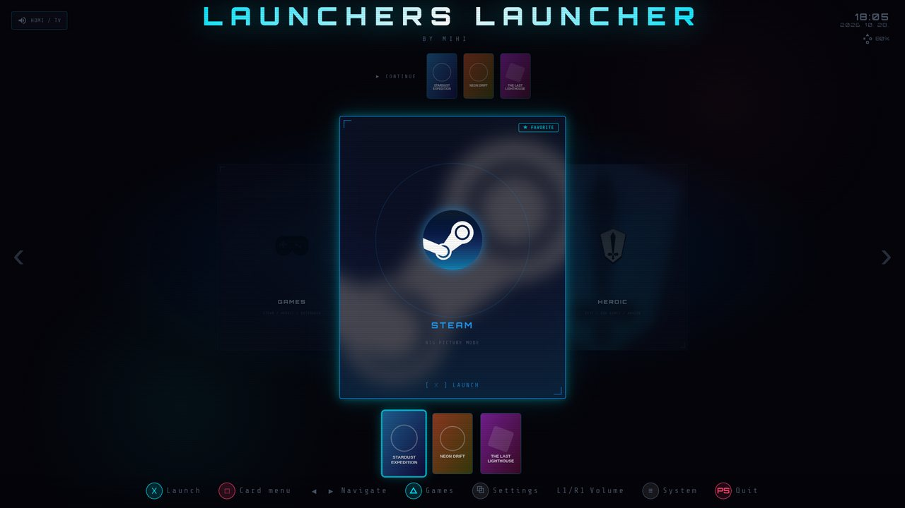

### Card menu (□ or a held ✕)

On a launcher card, **□** (or a held **✕**) opens the card's menu:

- **Move to front** — the card goes to the beginning of the row;
- **Open games list** — the Games panel opens straight with this launcher's games;
- **Accent colour** — the card's own colour;
- **Remove** — the card is taken off the home screen. For safety you must press ✕ **twice**, and then you can **undo it with △ for
  8 seconds**. (The program itself is not deleted from the machine.)

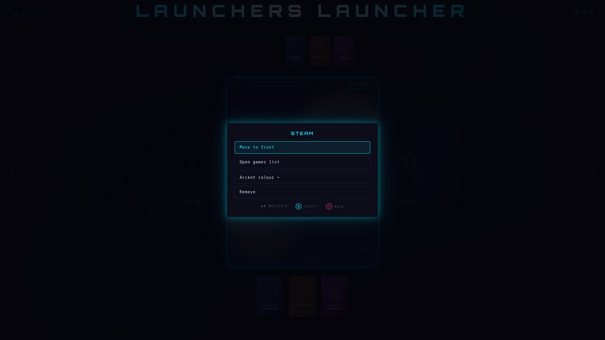

### System menu (Options / Menu button)

From anywhere on the home screen: **Power off**, **Restart**, **Sleep**, **Quit app**. The first three ask for **confirmation**
(another ✕), because the machine carries them out immediately.

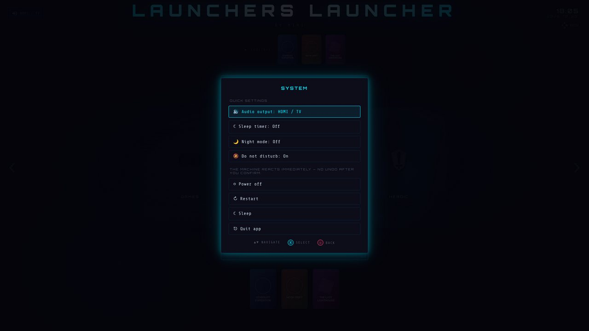

### Volume

**L1 / R1** always adjusts the machine's volume — on the home screen, in the menus, even in Settings. A bar at the bottom shows the
new value for a moment. (The step size and the ceiling can be set in Settings.)

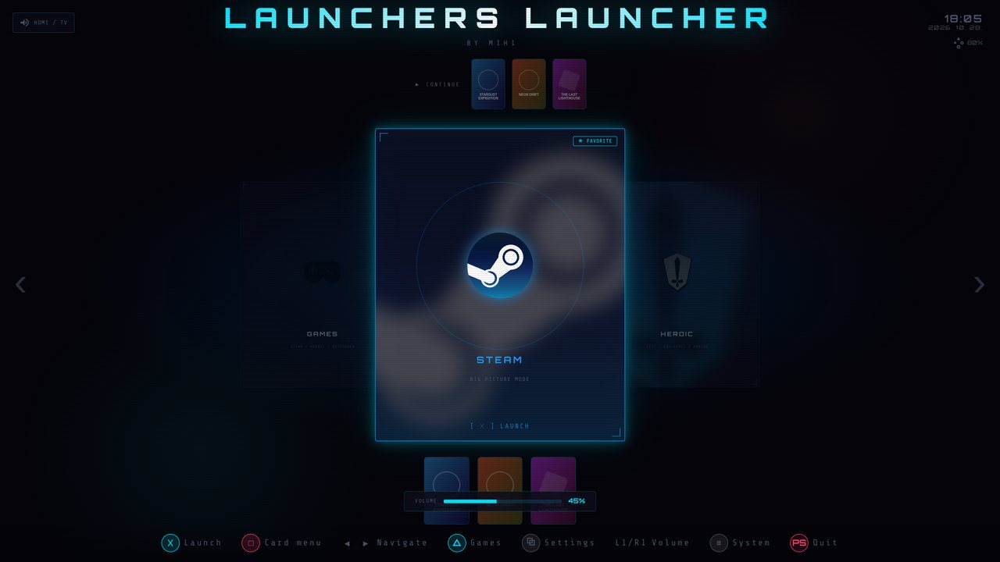

### Screensaver

If you do not touch the controller for a few minutes (3 by default), the screen goes dark and the launchers' icons slowly drift
across it — so an OLED TV does not suffer burn-in. Any button brings the home screen back.

---

## 4. The Games panel

Opens with the **△** button (or the "Games" card). All your installed games are in one place here: Steam, GOG, Epic, Amazon,
Lutris, RetroArch ROMs and the emulators' games.

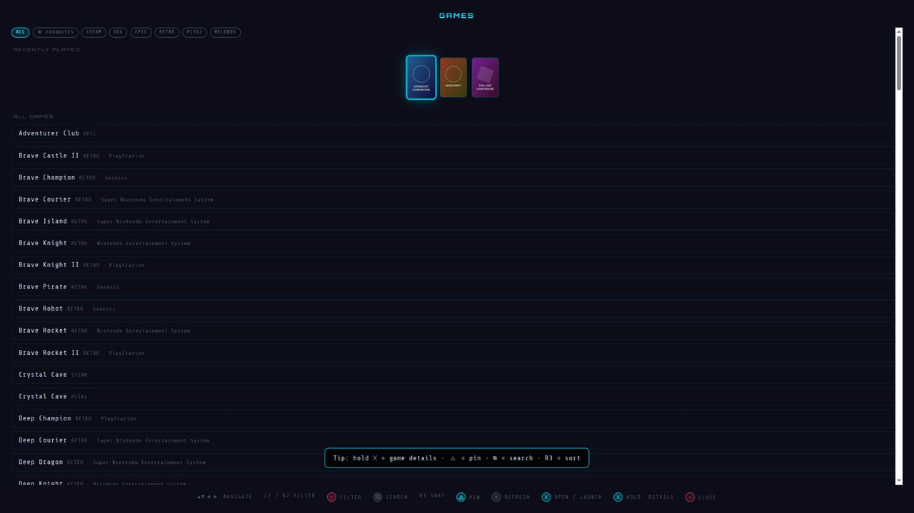

- **At the top the source strips** (ALL, ★ FAVORITES, STEAM, GOG, …): **L2 / R2** switches between them.
- A **"Recently played"** row at the top of the list, and below it **all games** in alphabetical order.
- A source can also be shown **as a grid with covers** (set per source: Settings → Games → Grid or list).

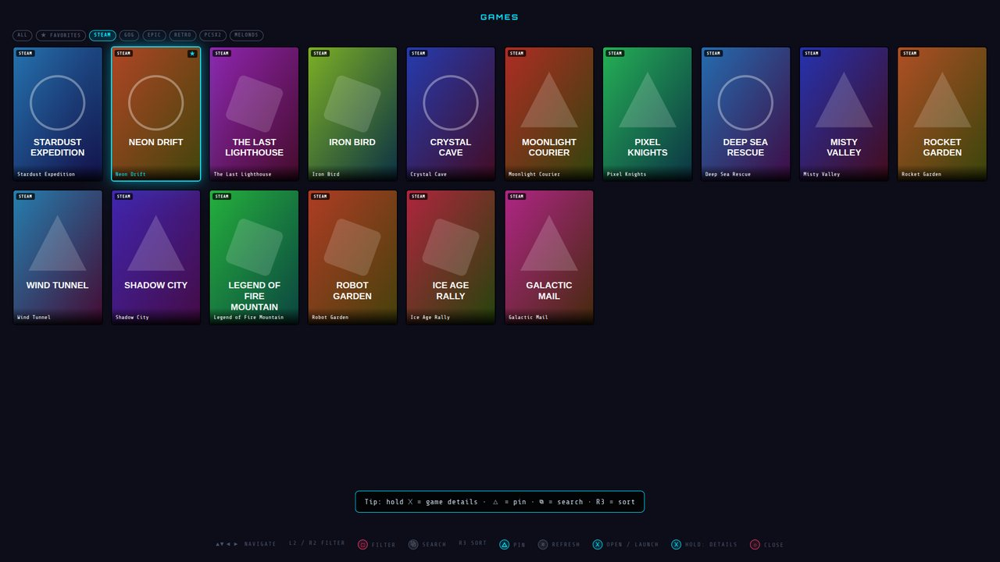

| Button | Effect in the Games panel |
|---|---|
| ✕ | start the game |
| ✕ held | the game's **details** (see below) |
| △ | pin to the **favorites** (★ mark); press again to unpin |
| □ | source filter: which sources appear in the ALL list |
| L2 / R2 | switch the source · in the RetroArch list, jump by letter |
| Share / View | **search** |
| Options / Menu | refresh — re-reads the game lists (e.g. after a new install) |
| ○ | close the panel |

The panel reopens where you closed it (the same source, the same game).

### Source filter (□)

Here you can switch off the sources you do not want to see in the ALL list (e.g. when thousands of RetroArch ROMs drown out the
rest). ✕ toggles, ○ closes.

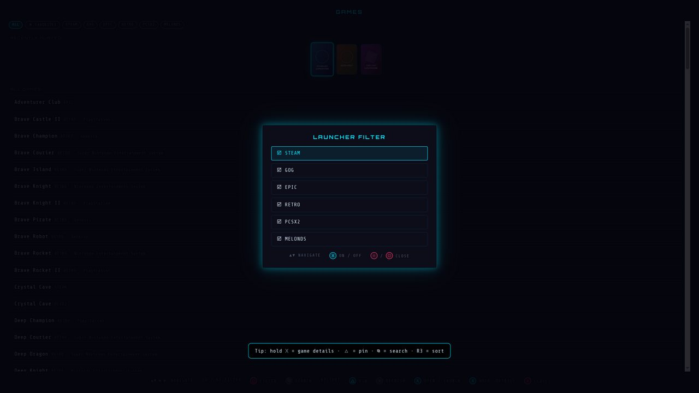

### Search

The **Share / View** button opens an on-screen keyboard. The list narrows immediately as you type. On the keyboard: **✕** = letter,
**□** = delete, **△** = space, **○** = done.

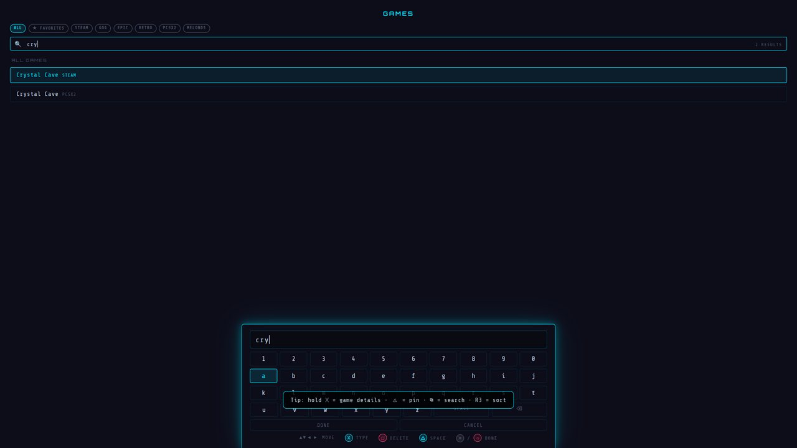

### Game details (held ✕)

Shows how much you have played it (launched from the launcher AND according to the program's own records), when you last played
it, and how many times you launched it. You can also start it from here, or pin it to the favorites.

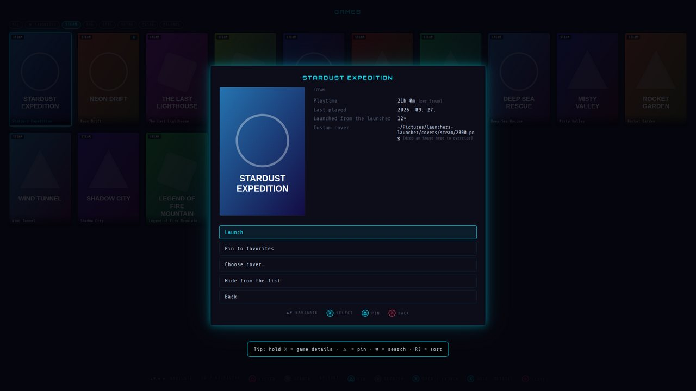

> **Custom cover:** if a game has no cover (or an ugly one), put an image at the path shown in the "Custom cover" row of the details
> (under `~/Pictures/launchers-launcher/covers/`). From then on the launcher uses that.

### RetroArch

RetroArch games appear per system (NES, SNES, Mega Drive, PlayStation, …); open a system with ✕, and inside it **L2 / R2** jumps
letter by letter — fast even with thousands of ROMs.

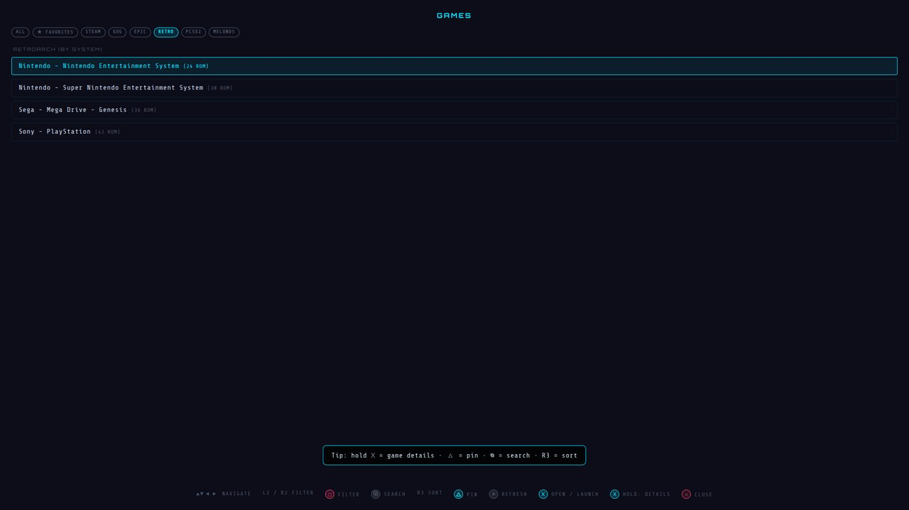

---

## 5. Settings

Opens with the **Share / View** button. On the left are the 8 categories, on the right the items of the selected category.
**▲ ▼** moves, **✕** enters, **○** goes back / closes. Settings also reopens where you closed it.

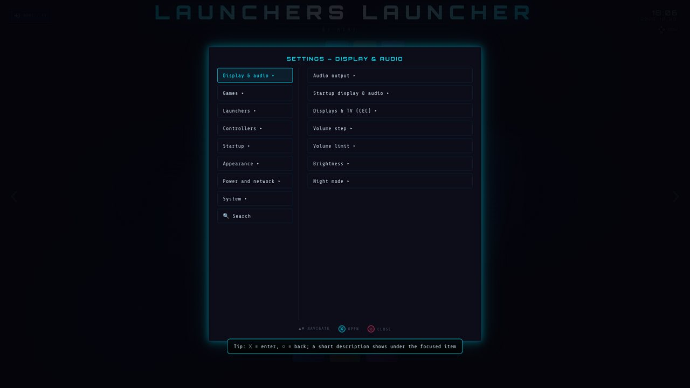

| Category | What you find in it |
|---|---|
| **Display & audio** | audio output · startup display & audio · displays & TV (CEC) · volume step and limit · brightness · night mode |
| **Games** | grid or list · recently played bars · cover download · clear cache · ROM folder permissions · playtime · back up game saves |
| **Launchers** | add / remove launchers · order · melonDS ROM folders |
| **Controllers** | Bluetooth controllers · controls · Bluetooth audio devices · disconnect controllers when idle |
| **Startup** | start on login · start on controller connect · main controller · close apps on TV mode · TV mode exit hold · always on top · do not disturb while playing |
| **Appearance** | theme · background · interface size · language · sound & rumble · accessibility · tips · screensaver |
| **Power and network** | Wi-Fi · power · sleep timer · automatic sleep |
| **System** | update · setup wizard · settings backups · transfer settings · diagnostics · log |

### Theme and background

**Appearance → Theme**: choose from 15 themes (✕ applies it at once). The **Background** can be set per theme; for your own
picture put a `.jpg` / `.png` file into the `~/Pictures/launchers-launcher/` folder.

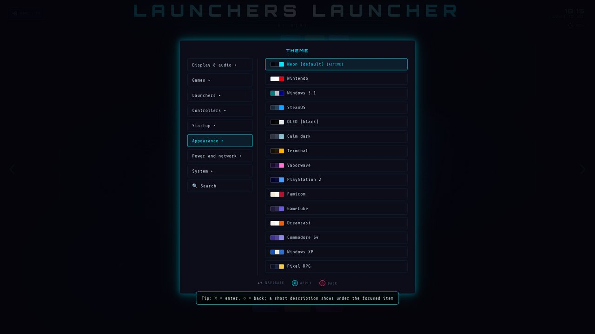

| Nintendo | Windows 3.1 |
|---|---|
| 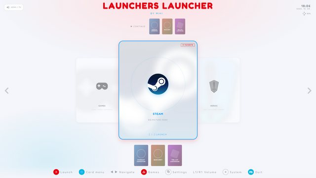 | 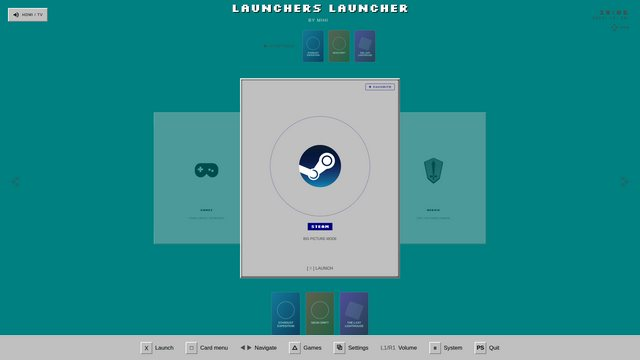 |
| **OLED (black)** | **SteamOS** |
| 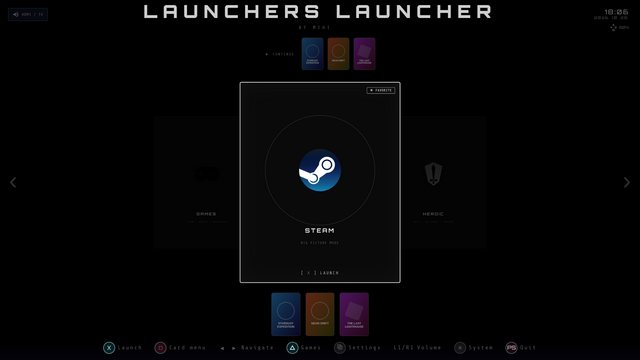 | 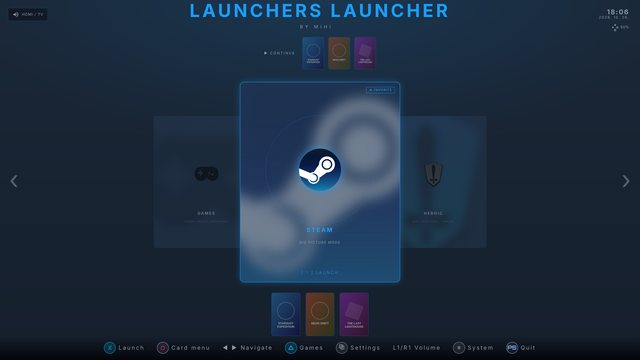 |

The **Interface size** (small / normal / large) is handy for a more distant couch; under **Accessibility** you find high contrast,
turning animations off, slower button repeat and screen-reader support.

### Pairing controllers

**Controllers → Bluetooth controllers**: the list shows the known controllers (with battery level); ✕ connects / disconnects. To
**search for a new device**, put the controller in pairing mode (DualSense: hold PS + Create until it flashes; Xbox: the pairing
button on top), then choose the "Search for new device" row. **Bluetooth audio devices** (headphones, speaker) works the same way.

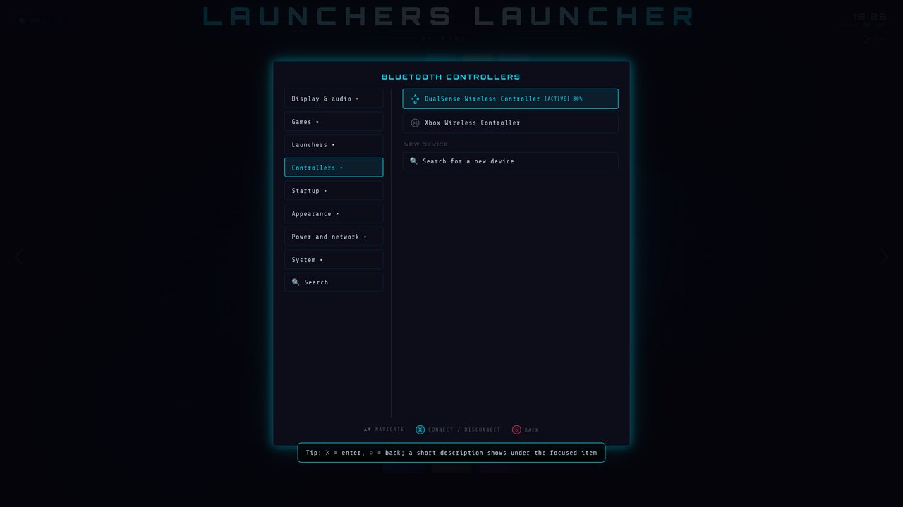

The **Controls** item shows the full button summary:

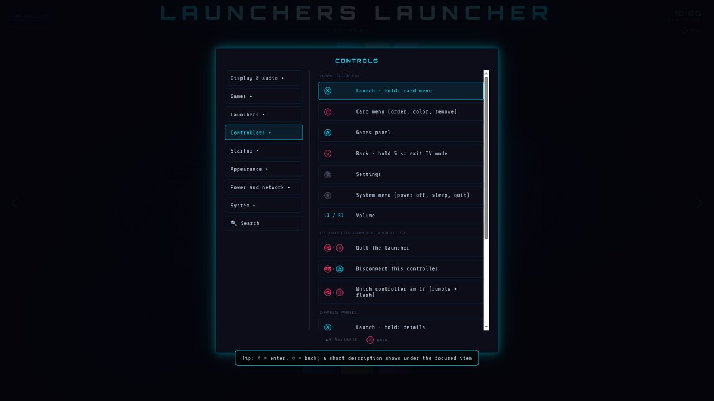

### Adding launchers

**Launchers → Launchers**: at the top the ones on the home screen, below them the programs found on the machine that are not
added yet. ✕ adds / removes a launcher; recommended programs that are not installed can be installed from here too (from Flathub).
**□** gives more options for a row (e.g. the native or flatpak variant, giving the program's folder by hand if the launcher does
not find it).

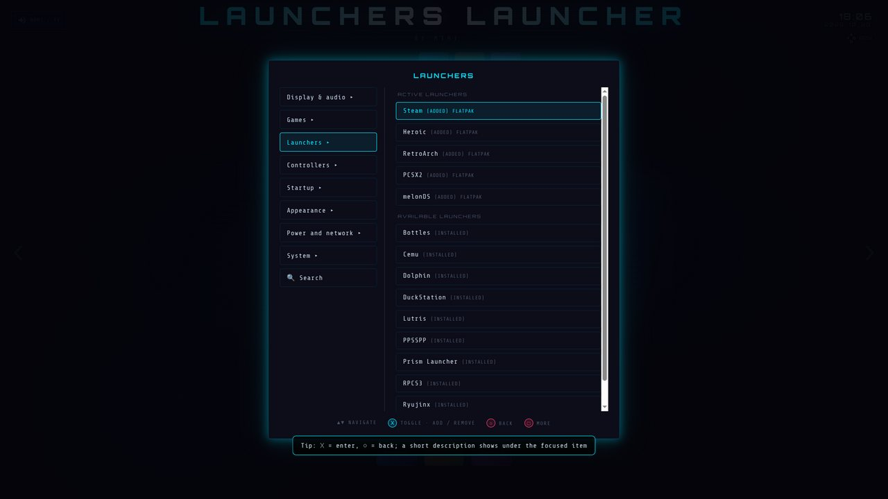

With the **"Add another program…"** wizard at the bottom of the list, any application installed on the machine can be added as a
card (e.g. a media player): you pick the program, and in the preview you can set its name, icon and colour.

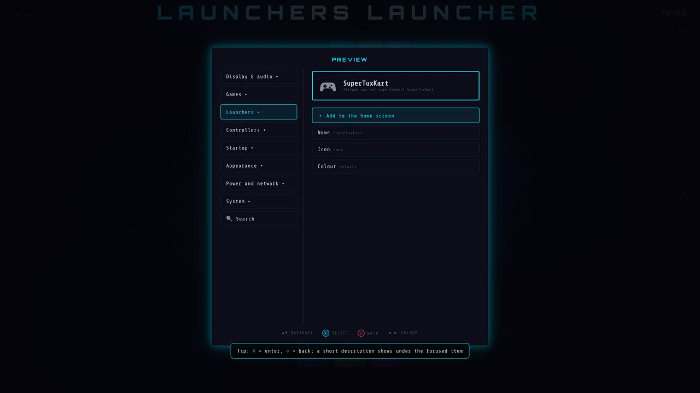

The order of the cards can be set in the **Launcher order** item (or with the card menu's "Move to front").

### Wi-Fi

**Power and network → Wi-Fi**: the visible networks with signal strength. For a new, password-protected network ✕ opens the
on-screen keyboard for the password. If the connection fails, the launcher goes back to the previous network.

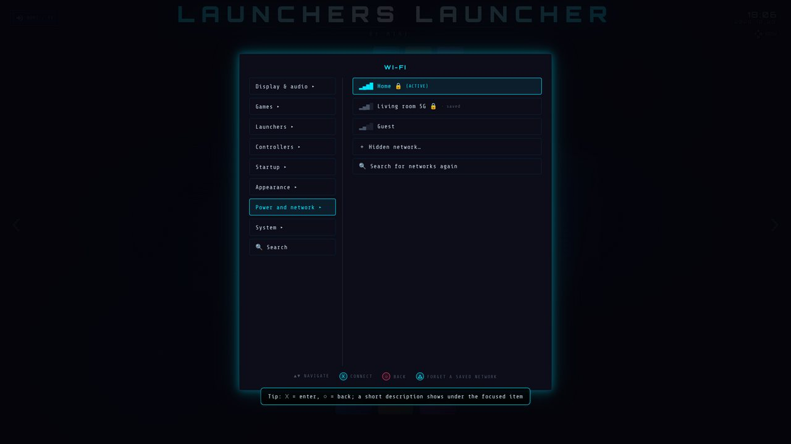

### Power and sleep

**Power and network → Power**: power off / restart / sleep (the same as the system menu). The **Sleep timer** puts the machine to
sleep after X minutes (for this occasion only), and **Automatic sleep** does so when the launcher has been idle on the home screen
for that long — it does not count during a game, and warns you a minute before.

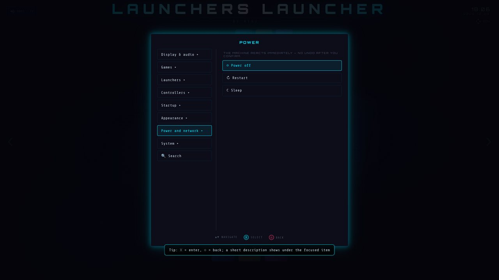

### Game saves

**Games → Back up game saves**: makes a backup of the emulators' saves with one button press (by default into the
`~/launchers-launcher-saves` folder; the last 5 are kept).

### Update

**System → Update**: shows whether there is a newer version, and ✕ downloads it and restarts the launcher. If the new version would
not even start, the launcher goes back to the previous one by itself.

---

## 6. TV mode

If the machine is set up that way (the installer offers it), **switching on the main controller** puts the machine into "TV mode":

1. it closes the programs listed under Settings → Startup → **Close apps on TV mode** (e.g. a browser, an email client),
2. starts the launcher,
3. switches to the **startup display and audio** (Display & audio → Startup display & audio),
4. if the machine has HDMI-CEC and the startup display is the TV itself, **it switches the TV on**.

**Leaving TV mode:** on the home screen hold **○** for **5 seconds** (this time is adjustable). The launcher restores the desktop
monitor and audio setup, disconnects the controllers, puts the TV into standby (if you asked for that), and closes.

> When you change the display in Settings, the launcher asks: **"Keep this display?"** If you do not answer (e.g. because no
> picture appeared), it goes back by itself after a few seconds.

---

## 7. When something does not work

- **A game / launcher does not start:** the reason appears at the bottom of the screen (e.g. "not installed"). If the message says
  `LOG`, within 10 seconds the **Share / View** button opens the log directly.
- **Log:** Settings → System → **Log**. It can be saved to a file (into your home folder) from there, if someone needs to be sent it.
- **Diagnostics:** Settings → System → **Diagnostics**. Shows whether the necessary system programs are present; the missing ones
  **can be installed from here** (the system then asks for your password in its own window — you need a keyboard for that).
- **No game in the list:** in the Games panel press the **Options / Menu** button (refresh). For an emulator, check that it sees
  the right folder (for a flatpak emulator the panel warns if the program cannot reach the ROM folder).
- **"⚠ SAFE MODE" banner:** the previous starts got stuck several times, so the launcher started cautiously this time (without
  display switching and TV power-on). If this start goes well, the next one starts the usual way; the log shows what got stuck.
- **You changed something by mistake:** Settings → System → **Settings backups** — the launcher makes a backup of your settings
  every day, and you can restore from those.
- **To restart the launcher:** PS + ○ (or the system menu's "Quit app" row) closes it. If TV mode is set up, switching the controller
  on next time starts it again; otherwise start it with the **Launchers Launcher** icon in the application menu.

---

## 8. Frequently asked questions

**Which controllers work?** DualSense (PS5), DualShock 4 (PS4), Xbox controllers and most generic USB / Bluetooth gamepads.

**Can it be used with a mouse / keyboard?** The home screen yes (◀ ▶ scroll, Enter launches, Esc quits, `t` changes the theme), but
the menus are made for a controller.

**Does removing a card delete the program?** No, it only takes it off the home screen. It can be added back at any time from
Settings → Launchers.

**Where do the covers come from?** From the launchers' own images (Steam, Heroic, RetroArch, …) or — if **Games → Cover download**
is on — from the internet. Your own image always takes precedence (see [Game details](#game-details-held-)).

**Can notifications appear during a game?** By default not: "Do not disturb while playing" is on (Settings → Startup).

---

Regenerating the images (for developers): `npm run user-guide-shots` — `tools/user-guide/user-guide-shots.js` photographs the
real interface with made-up sample data.
